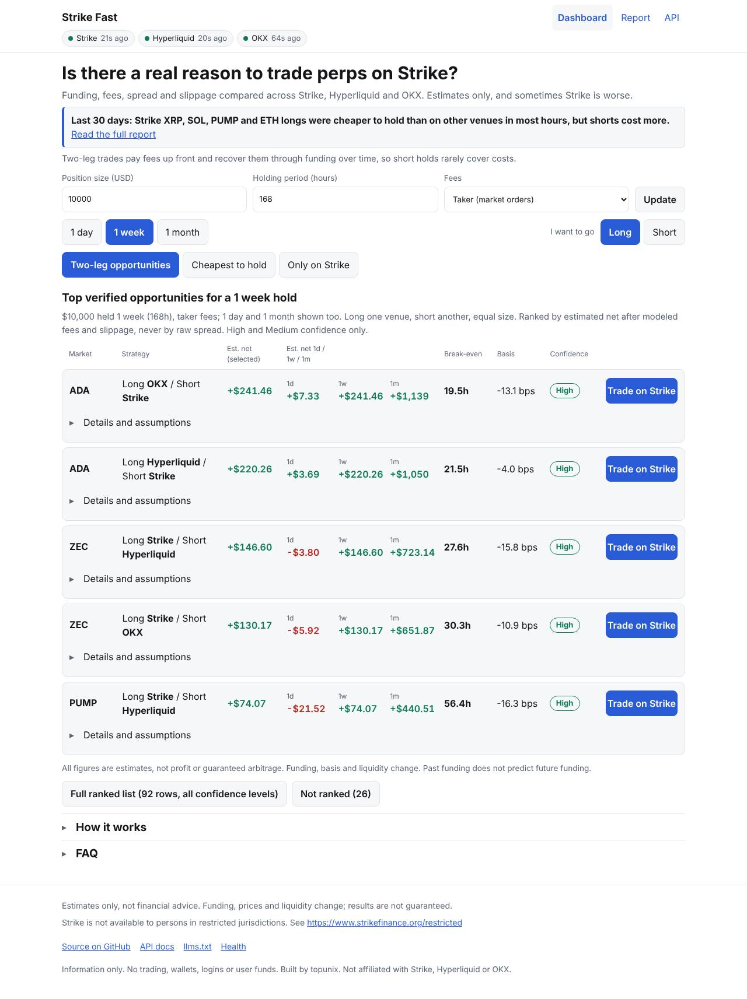
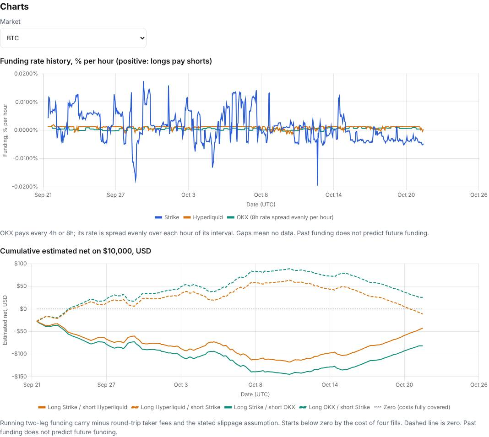
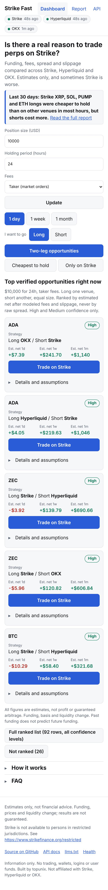
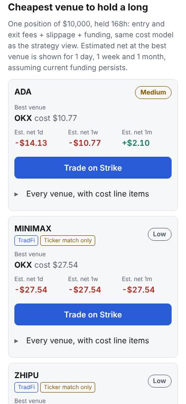
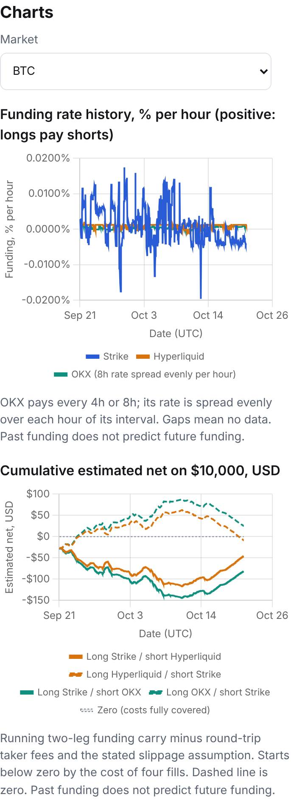

# Strike Edge

*Find the better trade. Strike fast.*

Strike Edge shows where a perp trade costs less across Strike, Hyperliquid and OKX, after funding, fees, spread and slippage. It reads live funding, prices and order books from all three venues and serves the results through a web dashboard, a JSON API, and an MCP server for AI agents.

Everything is an **estimate**, never "profit" or "guaranteed arbitrage". Information only: no trading, no wallets, no logins, no user funds.

**Three ways to use it**

- **Dashboard:** https://strike-edge.onrender.com
- **API for bots:** https://strike-edge.onrender.com/docs and https://strike-edge.onrender.com/llms.txt
- **MCP server for AI agents:** https://strike-edge.onrender.com/mcp (Claude Code: `claude mcp add --transport http strike-edge https://strike-edge.onrender.com/mcp`; more in [Use with AI agents (MCP)](#use-with-ai-agents-mcp))



## 30-day historical report

The [30-day historical report](https://strike-edge.onrender.com/report) reads 30 days of hourly funding for every matched market and shows how often Strike was the cheaper venue to hold, plus the estimated net of each two-leg trade after fees and slippage. Its charts show hourly funding on all three venues and a cumulative estimated net that starts below zero by the cost of four fills. Key findings, generated from the data:

- **Strike's ETH, SOL, XRP and PUMP perps traded below their index price in most hours** (Strike funding was negative in 65%, 80%, 82% and 62% of hours). As a result, **longs were cheaper to hold on Strike and shorts were more expensive.**
  - ETH: Strike was cheaper for longs in 84% of hours vs Hyperliquid and 73% vs OKX, and cheaper for shorts in only 15% and 27%.
  - SOL: longs 92% and 89%, shorts 7% and 11%.
- **ADA went the other way.** Strike's ADA perp traded above index (funding positive in 99% of hours), so shorts were cheaper to hold on Strike and longs were more expensive.
- **BTC was a toss-up.** Strike was cheaper for BTC shorts in 45% of hours vs Hyperliquid and 48% vs OKX, and for longs in 55% and 52%.
- **Most two-leg trades did not pay.** Of 81 market and direction pairs that passed the confidence checks, 31 had a positive estimated 30-day net after taker fees and slippage and 50 did not. The best was ADA (long OKX, short Strike) at about +$475 on $10,000; the worst was PUMP (long Hyperliquid, short Strike) at about -$252. Another 13 pairs were flagged "Low confidence: thin liquidity or extreme funding" and are left out of this summary (they stay in the report tables).
- **Why a discount to index matters, and its limit.** Strike's funding follows the gap between its perp price and its index price, so a persistently negative rate means the perp traded below index. That is what makes longs cheaper. It can change quickly, and it also affects entry and exit prices (basis), which the funding figures do not capture.



*Snapshot of a live `/api/v1/report` call on 2026-10-22 at 17:34 UTC. Window 2026-09-22 17:00 to 2026-10-22 17:00 UTC (720 hours), $10,000 position, taker fees; the "cheaper to hold" shares are funding only. Past funding does not predict future funding; this is not a forecast.*

## Ask an AI

Connected to the MCP server, an assistant answers this by calling the `get_report` tool:

> **Q:** Over the last 30 days, was Strike cheaper than Hyperliquid and OKX for holding ETH longs?
>
> **A:** Mostly yes. Strike was the cheaper venue to hold an ETH long in about **84%** of hours versus Hyperliquid and about **73%** versus OKX.

*Same snapshot as the report above (2026-10-22 at 17:34 UTC, 720 hours). Funding only; past funding does not predict future funding; not financial advice. Live per-hour answers from `get_holding_cost` can differ: the cheapest venue to hold changes with the current funding rate, so a single hour can go the other way without changing the 30-day pattern.*

## Who it is for

- **Traders and Strike holders** use the web dashboard: the top verified opportunities, the cheapest venue to hold a long or short, and a 30-day report.
- **Bots, quant desks and AI agents** use the versioned JSON API (`/api/v1`), OpenAPI docs at `/docs`, `/llms.txt`, and the MCP server at `/mcp` (see [Use with AI agents (MCP)](#use-with-ai-agents-mcp)). Both audiences get the same numbers from the same engine.

## How existing tools compare

As of 2026-10-21, from their public pages (check them directly; they change):

- **[Octav Perps](https://octav.fi/blog/perp-funding-rates-dashboard.md)** (post dated 2026-01-23) is a free funding-rate dashboard across Apex, Aster, Binance, Bybit, Hyperliquid, Lighter, OKX, Pacifica and Paradex. Strike is not listed. It ranks symbols by funding spread; the post does not describe fee- or slippage-adjusted figures, and the API it points to is for portfolio and funding position data, not a perps opportunities API.
- **[Otomato](https://otomato.xyz/tools/funding-rate-arbitrage)** (page accessed 2026-10-19) offers a funding rate arbitrage scanner covering Hyperliquid, Binance and Bybit. It ranks by net APR and states that its figures are an "Estimate before fees and slippage." Strike is not listed.

Strike Edge adds what a Strike trader needs: Strike coverage, results after fees and slippage at your size, an after-cost ranking exposed as an API, an MCP server for AI agents, and honest per-row confidence.

## Screenshots

<details>
<summary><b>Screenshots (mobile and desktop)</b></summary>

<p>



</p>

*Mobile, 375x812 viewport: dashboard, cheapest to hold, and the report charts.*

Desktop: [report](docs/screenshots/report-desktop.jpg) and [cheapest to hold](docs/screenshots/home-hold-desktop.jpg). All screenshots come from Playwright runs against live data (`scripts/check_layout.py`).

</details>

## What it shows

- **Two-leg strategy.** Long one venue, short another, equal notional. Net = funding on both legs minus fees on four fills minus slippage on four fills. It also shows break-even hours (round-trip costs divided by net hourly carry, only when carry is positive) and basis in bps. Rows are ranked by estimated net dollars after costs, never by raw spread.
- **Cheapest venue to hold.** One long or short position: entry and exit fees plus slippage plus funding for the holding period, per venue, with the best venue, the worst venue and the dollar gap. A direction toggle switches between long and short.
- **Move to Strike?** If you already hold a long or short on Hyperliquid or OKX, it compares keeping the position there with closing it and reopening on Strike over 1 week, 2 weeks or 1 month: the estimated saving (or a plain "staying is cheaper"), what switching costs up front, the hours until it pays for itself, and how often Strike was the cheaper venue for your side over the last 30 days.
- **Periods.** Rows show 1-day, 1-week and 1-month estimates side by side, assuming current funding persists. Round-trip costs are paid once, so short holds rarely cover them. The dashboard defaults to a 1-week hold.
- **Markets only on Strike.** Any Strike market without a matched competitor appears in its own section; today all 31 Strike markets have a match.
- **Historical report (`/report`).** 30 days of funding for every matched market: share of hours the two-leg carry was positive, days to cover round-trip fees, cumulative estimated net over 7 and 30 days, longest favorable stretch, and the share of hours Strike was the cheaper venue for longs and shorts. It starts with generated key findings and has two charts.

## How it uses Strike's API

All public, no auth, base `https://api.strikefinance.org`:

| Endpoint | Used for |
| --- | --- |
| `GET /price/v2/premiumIndex` | Mark, index, hourly funding rate, next funding time for all markets in one call. Also `interestRate` and `interestRateDampener`, used to classify TradFi markets. |
| `GET /price/v2/depth?symbol=BTC-USD&limit=50` | Order book for the slippage walk, fetched only for matched markets and staggered across each 60-second cycle. |
| `GET /price/v2/ticker/24hr` | 24-hour volume for all markets in one call. |
| `GET /price/v2/exchangeInfo` | Contract list and `rateLimits`, read at startup to size the outbound limiter. |
| `GET /stat/v1/stats/coin/history/funding?symbol=BTC-USD&days=30` | Hourly funding history for the report and charts. |

Strike's funding is hourly and positive means longs pay shorts. We checked the sign independently: Strike's funding sign agrees with the sign of its own mark-versus-index premium on every market with a meaningful premium. TradFi markets sit at exactly 0 inside Strike's dampener dead-band, which we report as 0, not as missing.

**Competitors.** Hyperliquid: `POST /info` with `metaAndAssetCtxs` (main dex and the HIP-3 `xyz` dex), `l2Book`, `fundingHistory` (paginated 500 rows at a time). OKX: `GET /api/v5/public/funding-rate?instId=ANY`, `/public/mark-price`, `/market/tickers`, `/market/books`, `/public/instruments` and `/public/funding-rate-history` (paginated with `after`).

## Methodology and assumptions

<details>
<summary><b>Methodology and assumptions (funding, fees, slippage, confidence, limits)</b></summary>

### Funding conventions

| Venue | Interval | Sign | Where it comes from |
| --- | --- | --- | --- |
| Strike | 1 hour | Positive: longs pay shorts | `premiumIndex.fundingRate`, history is hourly |
| Hyperliquid | 1 hour | Positive: longs pay shorts | `metaAndAssetCtxs.funding`, `fundingHistory` |
| OKX | Per instrument (1h, 4h or 8h), derived from `nextFundingTime - fundingTime` | Positive: longs pay shorts | `funding-rate.fundingRate`; history uses the settled `realizedRate` |

Every rate is normalized to hourly (rate per interval divided by interval hours). Displays show the raw rate per interval first, then hourly, then the 24-hour dollar figure on your size, with annualized APR small and last. Missing data is `null`; zero funding is `0`. The two are never mixed up. In the report, an 8-hour OKX payment is spread evenly over its 8 hours.

### Fees (configurable base tiers)

| Venue | Taker | Maker | Source and caveat |
| --- | --- | --- | --- |
| Strike | 0.050% | -0.005% (rebate) | [Strike's trading fees page](https://docs.strikefinance.org/perpetuals/trading-fees.md): base tier (Tier 0, $0 to $100K 30-day volume). |
| Hyperliquid | 0.045% | 0.015% | Hyperliquid's published base perps tier (checked in its docs on 2026-10-21). |
| OKX | 0.050% | 0.020% | Regular tier (Lv1) USDT perps; consistent across several secondary sources, but we could not fetch OKX's own fee page. Check your account tier. |

Maker figures are shown separately and labeled "if filled as maker". In maker mode slippage is assumed zero and fills are not guaranteed.

**Hyperliquid HIP-3 markets (the `xyz` dex: stocks, gold, silver, WTI, S&P 500).** The deployer fee on top of the base fee is not exposed by the API and can add 0 to 300% in the docs. We use the base fee (`HL_HIP3_FEE_MULTIPLIER=1.0`, configurable), which is generous to Hyperliquid in the comparison but possibly low. Those rows are marked "HL fee unverified (HIP-3 deployer fee not exposed)" and lose one confidence level.

### Slippage

For the chosen notional (default $10,000) we walk each venue's order book and take the average fill versus the book mid, for entry and exit. A book too thin for the size is marked "insufficient liquidity" and excluded from rankings. OKX sizes are converted from contracts to base units with `ctVal * ctMult`. The report uses each market's current book walk at $10,000 as its per-fill slippage (floor 2 bps, labeled when the floor or a fallback applies). That reflects current depth, not historical depth.

### Confidence (High, Medium, Low)

Based on data freshness (all legs under 2 minutes), book depth at your size, and how consistent the funding sign was over the last 24 hours. Then:

- **Low is forced** when the underlying market is closed (US stocks, Korean stocks, index and commodity futures hours, weekends and known holidays; a simple config, no external calendar), and for ticker-only matches.
- **One level lower** when the Hyperliquid fee is unverified (HIP-3).
- Venue data older than 5 minutes is stale: greyed out and excluded from rankings.

### Symbol map

Only exact underlying matches are mapped: all 31 Strike markets match on OKX; 28 also match on Hyperliquid (10 on the main dex, 18 on the HIP-3 `xyz` dex). NAS100, NIGHT and SKHYNIX are OKX-only. Notes on contract differences (collateral, reference price, trading hours) are in `app/config.py` and shown in the UI. Six markets (CXMT, DRAM, MINIMAX, SPCX, UNITREE, ZHIPU) are **ticker matches only**: always Low confidence, labeled "ticker match only", and left out of the default rankings (visible in the full list and with `include_unverified=true`). Strike's `underlyingType` is `COIN` for every market, so TradFi markets are identified with `interestRate == 0 and interestRateDampener > 0` from `premiumIndex`, plus an override list.

### Report guard

A market and direction whose absolute 30-day estimated net exceeds 5% of notional, or whose book is thin at the notional, is flagged "Low confidence: thin liquidity or extreme funding". It stays in the report tables but is excluded from the headline summary.

### Limits of this tool

Funding, basis and liquidity change. Estimates assume current funding persists. Basis and closing prices are not modeled. Binance is **not supported** because it geo-blocks our hosting region.

</details>

## API quickstart

The examples below call the live site; `http://127.0.0.1:8000` works the same when running locally. Interactive docs: `/docs` (OpenAPI at `/openapi.json`). Agents: `/llms.txt`, which embeds real example responses.

Every response carries `schema_version`, `generated_at_ms` and `generated_at_iso`, per-venue source timestamps (UTC ms and ISO 8601) with a `stale` flag, the assumptions used, and a disclaimer. Field names carry units (`net_usd`, `funding_rate_per_hour`, `basis_bps`). `null` means missing, never 0. Errors are always `{"error": "...", "detail": "..."}`.

```bash
# Ranked two-leg opportunities (ETH, 1 week, $10k, taker fees)
curl -s "https://strike-edge.onrender.com/api/v1/opportunities?symbol=ETH-USD&hours=168&notional=10000&fee_mode=taker"

# Cheapest venue to hold a long (1 week)
curl -s "https://strike-edge.onrender.com/api/v1/holding-cost?symbol=ETH-USD&side=long&hours=168"

# Should I move a position to Strike? ($50k long held on Hyperliquid, kept 2 weeks)
curl -s "https://strike-edge.onrender.com/api/v1/switch?symbol=ETH-USD&side=long&from_venue=hyperliquid&notional=50000&hours=336"

# Live funding, marks, volume and depth for every market
curl -s "https://strike-edge.onrender.com/api/v1/snapshot"

# 30-day report, hourly funding history, health
curl -s "https://strike-edge.onrender.com/api/v1/report"
curl -s "https://strike-edge.onrender.com/api/v1/history?symbol=BTC-USD&days=30"
curl -s "https://strike-edge.onrender.com/healthz"
```

Real top row from `opportunities?hours=168` (captured 2026-10-22 17:42 UTC; values change every minute):

```json
{
  "rank": 1, "symbol": "ADA-USD", "direction": "long_other_short_strike",
  "long_venue": "hyperliquid", "short_venue": "strike",
  "net_usd": 276.62,
  "net_usd_by_period": {"1d": 12.78, "1w": 276.62, "1m": 1288.03},
  "carry_usd_per_hour": 1.8323, "break_even_hours": 17.0, "basis_bps": -14.91,
  "confidence": "High", "stale": false
}
```

Query parameters: `opportunities` takes `min_net_usd`, `notional`, `hours`, `fee_mode=taker|maker`, `direction=long_strike_short_other|long_other_short_strike`, `symbol` and `include_unverified`. `holding-cost` takes `symbol`, `side=long|short`, `notional`, `hours` and `fee_mode`. `switch` takes `symbol`, `side=long|short` and `from_venue=hyperliquid|okx` (all required), plus `notional`, `hours` (default 336, two weeks) and `fee_mode`.

**A short Python example for a bot:**

```python
import time
import httpx

BASE = "https://strike-edge.onrender.com"


def opportunities(**params):
    while True:
        r = httpx.get(f"{BASE}/api/v1/opportunities", params=params, timeout=20)
        if r.status_code == 429:  # inbound limit: honor Retry-After
            time.sleep(int(r.headers.get("Retry-After", "10")))
            continue
        r.raise_for_status()
        return r.json()


data = opportunities(hours=168, notional=10_000, min_net_usd=25)
for o in data["opportunities"]:
    if o["confidence"] == "High" and not o["stale"]:
        print(f'{o["symbol"]}: long {o["long_venue"]} / short {o["short_venue"]} '
              f'est. net ${o["net_usd"]:.2f} over 1w, break-even {o["break_even_hours"]:.0f}h')
```

**Rate limits.** Inbound: about 60 requests per minute per client. Over the limit you get `429` with `Retry-After` and the `{error, detail}` body. `/healthz` is exempt. `/api/v1` responses are cached for about 30 seconds, so polling faster gains nothing. CORS is open for GET. Rate limiting is best-effort per client; it does not affect upstream API usage, which is fixed by the poller schedule.

<details>
<summary><b>Upstream limits (we are polite)</b></summary>

One token-bucket limiter per venue, shared by the poller and the history backfill, defaults to at most 50% of each published limit: Hyperliquid 1200 weight per minute per IP (`l2Book` weight 2, other info calls 20 plus 1 per 20 rows returned), OKX per endpoint (funding-rate-history is among the strictest at 10 requests per 2 seconds), and Strike's `rateLimits` from `exchangeInfo` (2400 weight per minute). Strike sends no usage headers and does not publish per-endpoint weights, so we assume conventional ones (`premiumIndex` 10, `ticker/24hr` 40, `depth` 5); any usage header it ever sends is recorded in `/healthz`. Batch endpoints are used wherever they exist. On `429` or `418` we honor `Retry-After`, otherwise back off exponentially with jitter, and mark that venue degraded in `/healthz`. The live poller has priority over the backfill. Per-venue upstream request counts per minute are in `/healthz`.

</details>

## Use with AI agents (MCP)

Strike Edge exposes a read-only [Model Context Protocol](https://modelcontextprotocol.io) server, so an AI assistant can ask it questions directly. It uses the official MCP Python SDK.

**Example questions to ask an assistant:**

1. "I hold a $50k ETH long on Hyperliquid for 2 weeks. Should I move it to Strike?"
2. "Over the last 30 days, was Strike cheaper than Hyperliquid and OKX for holding ETH longs?"
3. "Where is ETH cheapest to hold long for 1 week at $10k, after fees?" (live answer changes hourly)
4. "What are the best two-leg funding trades right now for a 1-week hold, and how confident are they?"
5. "Over the last 30 days, how often was Strike cheaper than Hyperliquid for holding SOL longs?"

**Remote endpoint:** `https://strike-edge.onrender.com/mcp` (Streamable HTTP, no login). Four tools, each a thin wrapper over the same logic as the matching `/api/v1` endpoint, with the same validation and the same numbers:

| Tool | Same as | Arguments |
| --- | --- | --- |
| `get_opportunities` | `/api/v1/opportunities` | `min_net_usd`, `notional`, `hours`, `fee_mode`, `direction`, `symbol`, `include_unverified` (all optional) |
| `get_holding_cost` | `/api/v1/holding-cost` | `symbol`, `side` (required); `notional`, `hours`, `fee_mode` |
| `get_report` | `/api/v1/report` | `symbol` (optional: returns that market's table; summary and findings stay global) |
| `get_switch_estimate` | `/api/v1/switch` | `symbol`, `side`, `from_venue` (required); `notional`, `hours`, `fee_mode` |

Every tool description states the units, that results are estimates (not financial advice), the freshness rules (data older than 5 minutes is stale and excluded from rankings), and the restricted-jurisdictions notice. Bad arguments and unknown symbols come back as tool errors with the same messages as the API. The inbound rate limit (about 60 requests per minute per client) applies to `/mcp` too. There is no authentication and there are no write actions.

**Add it to an MCP-capable client** (one that supports remote servers over Streamable HTTP):

- Claude Code: `claude mcp add --transport http strike-edge https://strike-edge.onrender.com/mcp`
- A desktop or web assistant with custom connectors (for example Claude): add a custom connector or remote MCP server and paste the URL above.
- Clients configured with a JSON file usually accept something like the following; the exact key names vary by client, so check its docs:

```json
{ "mcpServers": { "strike-edge": { "type": "http", "url": "https://strike-edge.onrender.com/mcp" } } }
```

**Run it locally over stdio** (for desktop clients that launch a command). It runs its own live poller, so the first data appears within about a minute and `get_report` needs about 3 minutes of history backfill. Clients start the command with a limited environment: if you reach the internet through a proxy or a custom certificate bundle, pass those variables in the config's `env` block, otherwise the tools report every venue as stale instead of inventing data:

```json
{ "mcpServers": { "strike-edge": { "command": "python", "args": ["-m", "app.mcp"], "cwd": "/path/to/strike-edge" } } }
```

**Or call it from Python** (a quick check that the endpoint works):

```python
import asyncio
from mcp import Client


async def main():
    async with Client("https://strike-edge.onrender.com/mcp") as client:
        result = await client.call_tool("get_holding_cost", {"symbol": "ETH-USD", "side": "long", "hours": 168})
        print(result.structured_content["best_venue"], result.structured_content["best_vs_worst_gap_usd"])


asyncio.run(main())
```

## Run locally

Python 3.12.

```bash
python3.12 -m venv .venv && source .venv/bin/activate
pip install -r requirements.txt
uvicorn app.main:app --host 127.0.0.1 --port 8000
```

Open http://127.0.0.1:8000. Quotes arrive within seconds, order books fill in over the first 60-second cycle, and the 30-day history backfills in the background in about 3 minutes (`/report` shows "history loading" until it is done). Data is cached in SQLite (`strikeedge.db`, or `DB_PATH`), and the backfill is resumable.

| Variable | Default | Meaning |
| --- | --- | --- |
| `STRIKE_REFERRAL_CODE` | none | If set, "Trade on Strike" links use `https://v2.strikefinance.org/referral/accept?code=CODE`, else they link to Strike without a code. |
| `ENABLED_VENUES` | `strike,hyperliquid,okx` | Venues to poll. |
| `DEFAULT_NOTIONAL` | `10000` | Position size in USD. |
| `DEFAULT_HOURS` | `24` | API default holding period. |
| `HOME_DEFAULT_HOURS` | `168` | Dashboard default holding period (1 week). |
| `HL_HIP3_FEE_MULTIPLIER` | `1.0` | Scales Hyperliquid fees on HIP-3 markets. |
| `REPORT_SLIPPAGE_BPS_PER_FILL` | `2.0` | Report slippage floor per fill. |
| `DB_PATH` | `strikeedge.db` | SQLite file. |

## Deploy to Render (free tier)

1. Push the repo and create a **Blueprint** from `render.yaml` (a free Python web service), or create a web service by hand with build command `pip install -r requirements.txt` and start command:
   `uvicorn app.main:app --host 0.0.0.0 --port $PORT --proxy-headers --forwarded-allow-ips="*"`
2. Choose the branch to deploy (for example `main`), set `STRIKE_REFERRAL_CODE` if you have one (never commit it), and keep `/healthz` as the health check.

**Free tier behavior to plan for:**

- The service **sleeps after about 15 minutes idle** and wakes on the next request.
- Its **disk resets on restart**, so the SQLite cache is lost. On a cold start the app re-backfills 30 days of history in **about 3 minutes**, and `/report` shows "history loading" until then. The live dashboard works from live data in the meantime.
- **Open the site 5 or more minutes before a demo** so the poller has a few cycles and the history has loaded.

## Tests and tooling

```bash
pip install -r requirements-dev.txt
ruff check .
pytest                 # unit, API, rate-limit and UI tests on saved real fixtures
pytest --live          # one live smoke test against the real APIs (skipped by default)
python scripts/check_layout.py http://127.0.0.1:8000 docs/screenshots   # Playwright, 375px and 1280px
python scripts/capture_examples.py http://127.0.0.1:8000                # refresh /llms.txt examples
```

The calculation tests include hand-worked dollar scenarios, funding sign conventions, 1h versus 8h intervals, missing versus zero funding, OKX contract-size conversion, pagination, stale exclusion and a regression test on a real ETH and SOL hour. The Playwright check loads every page at 375px and 1280px, asserts no horizontal overflow and that charts render, and saves screenshots.

## What's next

These are plans, not promises. None of them is built yet.

- **Trade from an opportunity with Strike builder codes.** A "Trade this on Strike" button that opens the position (or both legs of a two-leg trade) through [Strike's builder code API](https://docs.strikefinance.org/api/builder-codes). The user would approve a maximum fee with a wallet signature and keep control of withdrawals. It would only launch where permitted, and only after confirming the terms with Strike.
- **More venues.** Lighter and Aster first, then others such as Apex, Pacifica and Paradex. Each would be added only after it passes the same accuracy checks as the current venues.
- **Alerts.** Telegram or Discord alerts when a verified opportunity crosses a threshold.
- **Longer history and persistent storage.** A report that covers more than 30 days and survives restarts (today the free host's disk resets on restart, so history reloads in about 3 minutes).
- **Hardening.** Fix how the rate limiter identifies clients, as described in [docs/TODO-rate-limit-client-key.md](docs/TODO-rate-limit-client-key.md).

## Author and license

Author: **topunix**. Released under the MIT license, see [LICENSE](LICENSE). Strike Edge is not affiliated with Strike, Hyperliquid or OKX. Built for the Strike Finance hackathon, October 2026.
